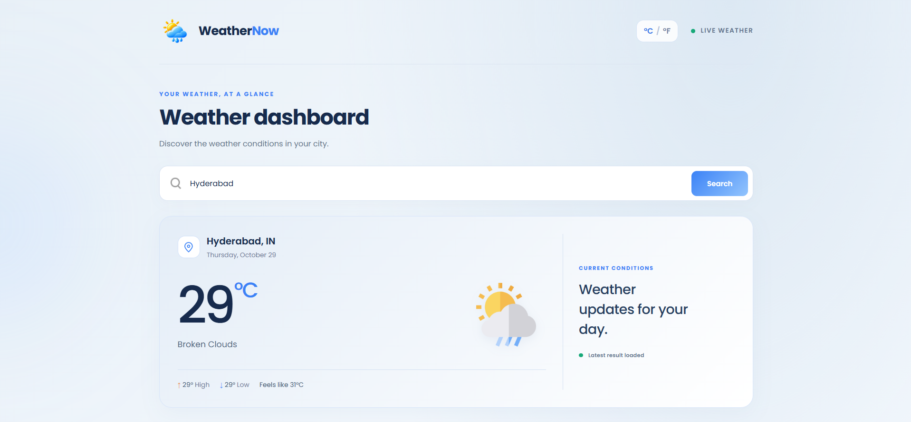
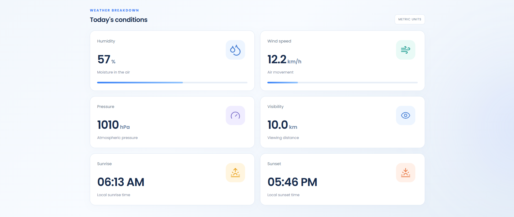
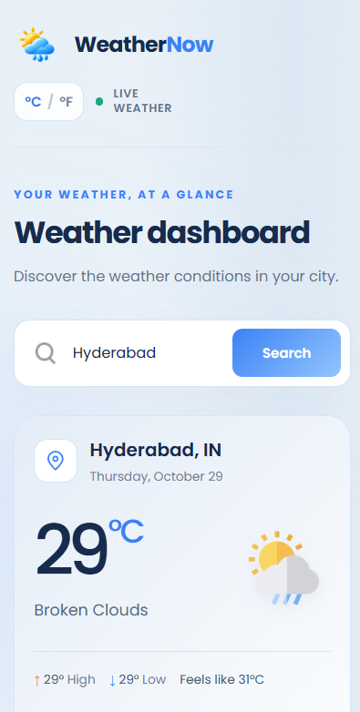

# 🌦️ WeatherNow

A modern and responsive weather dashboard that helps users explore current weather conditions, temperature, and forecasts for different cities.

## 📌 About the Project

WeatherNow is a weather dashboard application built with React.js, CSS3, and Vite.

The application uses the OpenWeatherMap API to retrieve current weather conditions and forecast data for searched cities. It provides a clean interface for viewing temperature, weather conditions, and additional weather details.

The project was designed with a focus on a modern user interface, responsive layouts, dynamic weather-themed backgrounds, and a smooth user experience across desktop and mobile devices.

## ✨ Features

- 🔎 Search weather by city name
- 🌡️ View current temperature
- 🔄 Switch between Celsius and Fahrenheit
- 🌤️ Display current weather conditions
- 📅 View weather forecasts
- 💧 View humidity levels
- 💨 View wind speed
- 🌡️ View atmospheric pressure
- 👁️ View visibility information
- 🌅 Display local sunrise and sunset times
- 🌡️ View feels-like temperature
- 📈 Display daily high and low temperatures
- 🎨 Dynamic weather-themed backgrounds
- 🖼️ Weather icons for different conditions
- ⏳ Loading states during weather requests
- ⚠️ Error handling for unsuccessful requests
- 📱 Responsive design for desktop and mobile
- ♿ Keyboard focus indicators and accessibility considerations
- 🚀 Deployed using GitHub Pages

## 📸 Screenshots

### Home Page

### Current Weather

### Mobile View

## 🛠️ Tech Stack

### Frontend

- React.js
- JavaScript (ES6+)
- HTML5
- CSS3
- Vite

### API & Weather Data

- OpenWeatherMap API

### Libraries & Tools

- Lucide React — icons
- React Toastify — toast notifications
- Git — version control
- GitHub — source code hosting
- GitHub Pages — deployment

## 📁 Project Structure

WeatherNow/
│
├── public/
│   └── weather-logo.png
│
├── screenshots/
│   ├── home.png
│   ├── current-weatherconditions.png
│   └── mobile.png
|
├── src/
│   ├── Climate.jsx
│   ├── Climate.css
│   ├── App.jsx
│   ├── main.jsx
│   └── index.css
│
├── .github/
│   └── workflows/
│       └── deploy.yml
│
├── .gitignore
├── index.html
├── package.json
├── package-lock.json
├── vite.config.js
└── README.md

## 🚀 Getting Started

### Prerequisites

- Node.js
- npm
- An OpenWeatherMap API key

### 1. Clone the repository

git clone https://github.com/Kalyansai78/WeatherNow.git

### 2. Navigate to the project directory

cd WeatherNow

### 3. Install dependencies

npm install

### 4. Configure the API key

Create a `.env` file in the project root:

VITE_APP_ID=your_openweathermap_api_key

Replace `your_openweathermap_api_key` with your actual API key.

**Important:** Never commit your `.env` file or expose your API key in public source code. Because Vite exposes `VITE_` variables in the browser bundle, this variable is not secret once the application is built. Configure appropriate API restrictions and usage limits.

### 5. Start the development server

npm run dev

Open the local URL displayed in your terminal.

### 6. Build for production

npm run build

### 7. Preview the production build

npm run preview

## 🌍 Deployment

WeatherNow is deployed using GitHub Pages.

The project uses Vite's `base` configuration for the repository path:

base: '/WeatherNow/',

The production build is generated in the `dist/` directory.

If you use GitHub Actions to deploy the application, configure the required API key as a repository secret named `VITE_APP_ID` and pass it into the build step.

## 👨‍💻 Author

**Kalyan Sai**

GitHub: [@Kalyansai78](https://github.com/Kalyansai78)